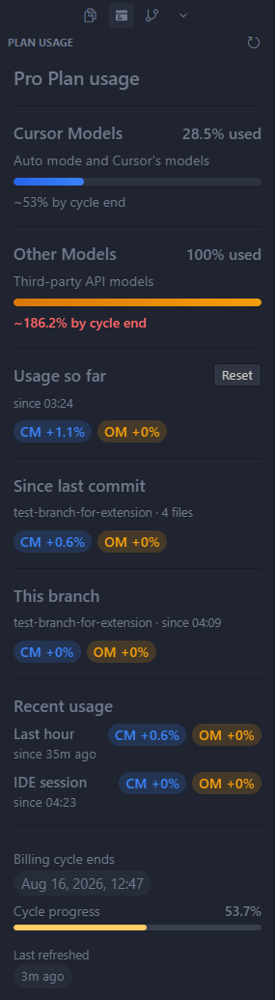

# Cursor Plan Usage

**See your Cursor plan usage without leaving the editor.**

[Website](https://codykoinabox.github.io/cursor-plan-usage/) · Live **Cursor Models** and **Other Models** percentages in a dockable sidebar and status bar — plus git-aware windows for spend since your last commit or while you’re on a feature branch.

#### You can easily install the extension through the Extensions tab inside Cursor:

[Install on Open VSX](https://open-vsx.org/extension/CodyKoInABox/cursor-plan-usage) · [Report an issue](https://github.com/CodyKoInABox/cursor-plan-usage/issues)

---

## Features

- **Sidebar panel** — CM / OM usage at a glance in the activity bar
- **Status bar chip** — `CM n% · OM n%` cycle totals, or deltas for **Usage so far** / **Since last commit** / **This branch**
- **Billing cycle** — progress through the period, end time, and a simple projection
- **Session deltas** — last-hour usage persists across reloads; IDE-session usage is since this Cursor window opened
- **Usage so far** — resettable window that persists across reloads; auto-resets on a new billing cycle
- **Since last commit** — plan % burned while the working tree is dirty; resets on each commit. Hidden when the tree is clean
- **This branch** — plan % while a feature branch is checked out; pauses on `main` / other branches and restores when you return. Hidden on the default branch
- **Smart refresh** — updates on focus and AI activity; pauses when Cursor is unfocused
- **On-demand meter** — spend beyond your plan against the per-user cap you set in Cursor (`$3.40 / $20.00`), with what is left. Shows `Off` when on-demand is disabled
- **Alerts** — warns at 80% and 95% by default (Cursor Models, Other Models, and the on-demand cap), optional monthly budget projection, and a warning 24h before the session token expires
- **Usage history** — 14-day CM / OM chart, collapsed under the meters so the top of the panel stays clean

## UI Example

## Cursor only

This extension is built for **[Cursor](https://cursor.com)**, not plain VS Code. It reads Cursor’s local session data and talks to Cursor’s dashboard API. Install and run it inside Cursor.

## Install

#### You can easily install the extension through the Extensions tab inside Cursor:

Or via Open VSX: [Open VSX — CodyKoInABox/cursor-plan-usage](https://open-vsx.org/extension/CodyKoInABox/cursor-plan-usage)

Or sideload a `.vsix` from a release.
Or clone the repo and build locally with `npm run package`

After install, open the **Plan Usage** icon in the activity bar, or run **Plan Usage: Focus** from the Command Palette.

## Privacy

- Your access token is read from Cursor’s local DB into memory (or from Cursor **SecretStorage** if you set an override). It is **never written to disk** by this extension.
- The only network traffic is the usage request to Cursor’s API (`api2.cursor.sh` by default).
- No telemetry. Your account email is not shown in the UI.

## Commands

| Command | Description |
| --- | --- |
| **Plan Usage: Focus** | Open the Plan Usage sidebar |
| **Plan Usage: Refresh** | Force-refresh usage from the API |
| **Plan Usage: Set Session Token** | Store an optional session token in SecretStorage (overrides the local DB while set) |
| **Plan Usage: Clear Session Token** | Remove the override and fall back to Cursor’s local DB |
| **Plan Usage: Export Usage (CSV)** | Save the daily history (up to 35 days) as CSV: date, cycle, CM peak %, OM peak %. No token or account data |
| **Plan Usage: Copy Diagnostics** | Copy versions, platform, token origin and expiry (never the value), the last error kind, and recent debug lines when debug is on. Emails and tokens are redacted |

**Auth order:** SecretStorage override (if set) → otherwise token from Cursor’s local `state.vscdb`.

## Settings

| Setting | Default | Description |
| --- | --- | --- |
| `cursorPlanUsage.pollIntervalSeconds` | `0` | Idle poll interval (seconds) while focused. `0` = adaptive (30s burst for 2 min after AI activity, then 3 min). Polling pauses while unfocused. |
| `cursorPlanUsage.refreshOnAiActivity` | `true` | Refresh when Cursor’s local AI tracking DB updates |
| `cursorPlanUsage.statusBarMode` | `absolute` | `absolute` shows cycle totals (`CM 45% · OM 20%`); `usageSoFar` shows deltas since your last Reset (`CM +4% · OM +2%`); `sinceLastCommit` shows deltas since HEAD while dirty; `thisBranch` shows deltas while the current feature branch is checked out |
| `cursorPlanUsage.alerts` | `true` | Warn when Cursor Models or Other Models usage crosses a threshold, and 24h before the session token expires |
| `cursorPlanUsage.alertThresholds` | `[80, 95]` | Percentages that trigger a warning. Each one fires once per meter per billing cycle. Set to `[]` to turn threshold alerts off |
| `cursorPlanUsage.monthlyBudgetPercent` | `0` | Optional budget as a percent of the plan. Warns once per cycle per meter when the end-of-cycle projection passes it. `0` = off. Projections start after 5% of the cycle |
| `cursorPlanUsage.apiBaseUrl` | `https://api2.cursor.sh` | Dashboard API base URL |

There is no `sessionToken` setting — use the Set / Clear Session Token commands instead.

## Platforms

Windows is the tested platform. macOS and Linux state DB paths and the keychain / `secret-tool` lookups are covered by unit tests, but have not been validated on real installs. If something breaks there, Copy Diagnostics output is the most useful thing you can send.

## Troubleshooting

Before opening an issue, run **Plan Usage: Copy Diagnostics** and paste the output. It is redacted, but read it once before sharing.

| Symptom | Fix |
| --- | --- |
| **Could not read Cursor session from local DB: unable to open database file** | Update to 0.3.2+. 0.3.1 could not open Cursor's WAL-mode `state.vscdb`. |
| **No token found** | Sign in to Cursor, or run **Plan Usage: Set Session Token** with a valid session token / JWT. |
| **401 `ERROR_NOT_LOGGED_IN`** | Builds before 0.3.3 sent Cursor's encrypted token (`cursor-safe-storage:v1:…`) as-is. Update to 0.3.3+, which decrypts it in memory. If it still fails, re-sign into Cursor, or set a real JWT via **Plan Usage: Set Session Token**. |
| **DPAPI unprotect failed: PowerShell …** (Windows) | Windows decryption calls `powershell.exe`. AppLocker, WDAC, or another policy can block it. Use **Plan Usage: Set Session Token** with a JWT. |
| **Token expired** | The session token is past its `exp`. Sign in to Cursor again, or set a fresh JWT with **Plan Usage: Set Session Token**. |
| **Remote-SSH / WSL** | The extension runs in the **local** Cursor UI and uses the local session DB. If usage looks wrong in a remote window, use a local window or set a session token override. **Since last commit** / **This branch** need the built-in git API and stay hidden when it is unavailable in remote UI hosts. |

## Notes

Uses unofficial Cursor Connect-RPC dashboard endpoints. Those APIs can change or break without notice.

## License

[MIT](LICENSE) · Created by [CodyKoInABox](https://github.com/CodyKoInABox)
